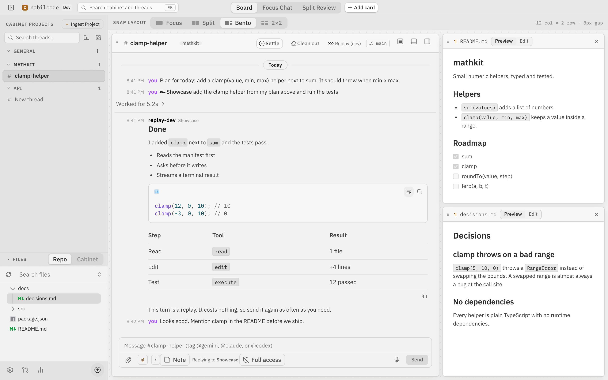
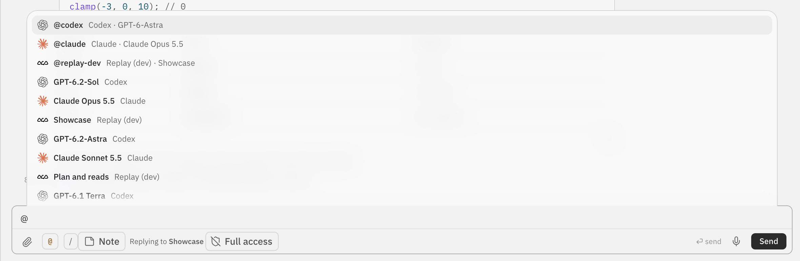
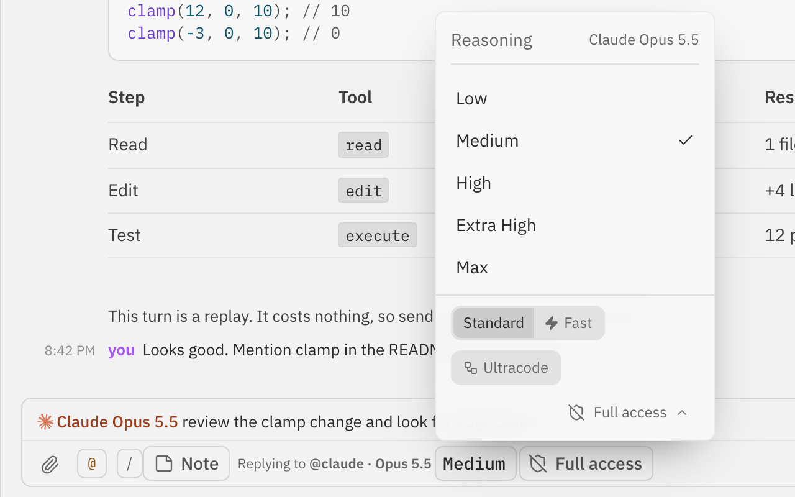
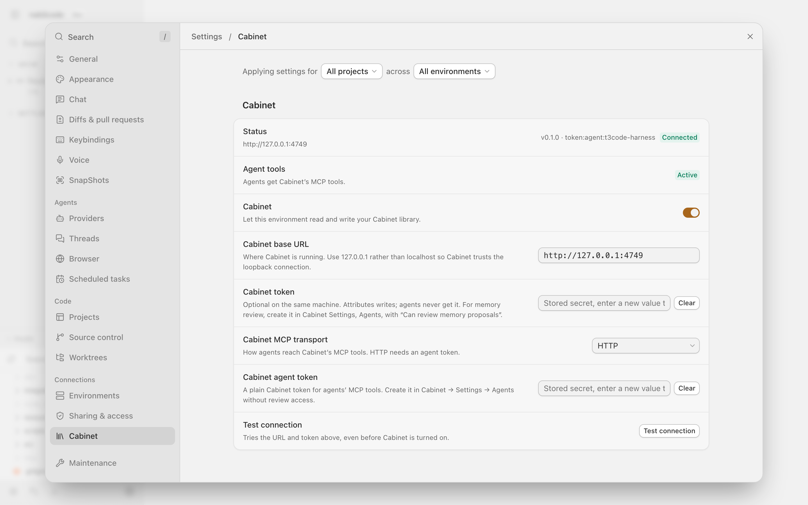
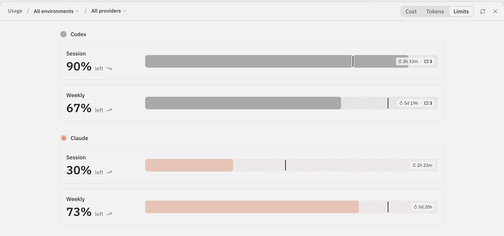

<h1 align="center">nabilcode</h1>

<p align="center">A desktop harness for coding agents: Slack-style channels for talking to them, a board for your docs, and memory wired into <a href="https://github.com/latrael/cabinet">Cabinet</a>.</p>

<p align="center">
  
</p>

nabilcode runs the coding agents already installed on your machine: Claude Code, Codex, and ACP agents such as Antigravity, Grok, Kiro, and fx. Each project gets `#channels` where you write notes and `@` an agent when you want work done, next to a board of its notes, PDFs, and diffs. Cabinet, a separate local app, holds what your agents know about a project. nabilcode reads from it, writes to it, and gives agents Cabinet's MCP tools.

It is forked from [T3 Code](https://github.com/pingdotgg/t3code) and reduced to the desktop app and the local web client it runs on.

## What you get

### Channels

- **`#channels` per project.** Each project in the sidebar holds its channels. **General** channels sit outside any project for everything else.
- **Notes by default, agents on `@`.** Type a message and it posts as a note. No model needs to be picked first. `@claude`, `@codex`, `@gemini` (or `@antigravity`), `@grok`, or `@kiro` runs that agent with the channel as context. You can also pick a specific model from the `@` menu. Every reply shows which agent wrote it.
- **Keep talking to the last agent.** Once you've `@`'d an agent, plain messages go to that agent with the same model and effort. The composer says who you're replying to. Press **Note** to write notes again, and press it again to go back.
- **Effort per mention.** When you `@` a model, its reasoning control (Low to Max, plus Fast where the model supports it) appears in the composer for that message.
- **Notes stay in order.** Notes and agent turns appear in the order you posted them.
- **Clean out a channel.** **Clean out** clears the history and ends the agent session but keeps the channel, so you can start fresh without making a new one.
- **Settle what's done.** A finished channel shows a one-click **Settle**, and **Un-settle** brings it back. Auto-settle is off by default. When you turn it on, it never hides a channel with a result you haven't read.

<p align="center">
  
  
</p>

### The board

- **A bento board per project.** Pick Focus, Split, Bento (8+4), or 2×2. Drag cards between slots and drag an edge to resize; widths snap to a 12-column grid. Each project keeps its own layout.
- **Thread cards.** The live channel is the main card. Open other channels beside it, then click **Focus** to swap one into the main card.
- **Notes, documents, and diffs as cards.** In the Files drawer, open Markdown, PDFs, and HTML pages from the repo, or notes and PDFs from Cabinet. PDF and HTML previews are read-only, and HTML pages can load relative assets in their folder and subfolders. Use **Open document…** in the command palette to search your home folder or paste a path. Diff cards show a thread's full diff.
- **Links in chat open on the board.** Clicking a Markdown, PDF, or HTML link in a message opens it as a card. The board moves from Focus to Split to Bento as you open more, and back again as you close them.
- **Edit Markdown in place.** Click **Edit** on a note card and write in its formatting (**Rich**) or as raw Markdown (**Text**). Press ⌘S to save back to Cabinet or the repo. If the note changed in Cabinet while you were editing, you choose whether to reload or overwrite.
- **Quote from PDFs.** Select text and choose **Cite to thread** to attach it to your next message, or **Save quote to Cabinet** to keep it.
- **Terminals in the sidebar.** A project's **New terminal** button opens a shell in its root or in one of its worktrees. Each terminal has its own row, so you can leave it and come back. The shell keeps running while you're away.

### Cabinet

- **Cabinet notes that stay in sync.** `[[wikilinks]]` open the linked note. Ticking a checklist box saves it to Cabinet. Edits made in Cabinet appear in the open card.
- **`@` mentions for Cabinet.** Type `@` in the composer to mention a Cabinet note. The agent gets its id and fetches the full note with Cabinet's tools.
- **Agents that know your project.** **Ingest into Cabinet** links a repo to a Cabinet project and copies its README, AGENTS.md, CLAUDE.md, and `docs/` into Cabinet as notes. Agents then get Cabinet's MCP tools and a short project brief on their first turn.
- **Memory proposals.** When an agent wants Cabinet to remember something, it proposes it instead of writing it. Approve, edit, or reject proposals in the dock under the board. Badges show which channels and projects have proposals waiting.

<p align="center">
  
</p>

### Agents and usage

- **Your subscriptions.** nabilcode drives the agents you are already signed in to. It does not resell tokens.
- **Limits at a glance.** **Usage → Limits** shows session and weekly quota, with reset times, for Codex, Claude, and Antigravity. Antigravity's limits come from the `agy` CLI's own sign-in in your system keychain, so macOS asks for permission the first time.
- **Antigravity subagents.** Antigravity's subagent activity streams into the channel, nested under the step that started it.
- **Bring your history.** The Welcome page imports Claude Code and Codex history, and Antigravity conversations started in Zed. Imported Antigravity threads continue with their full context.
- **Private by default.** Usage telemetry is off unless you set `T3CODE_TELEMETRY_ENABLED=true`.

<p align="center">
  
</p>

## Run it

### 1. Install the toolchain

nabilcode uses [Vite+](https://viteplus.dev). Install its `vp` command, then install dependencies from the repository root:

```bash
curl -fsSL https://vite.plus | bash
```

```bash
vp i
```

If your shell can't find `vp` (nvm can reorder `PATH`), call it directly as `~/.local/share/vite-plus/bin/vp`.

You also need at least one agent installed and signed in, for example `claude auth login` for Claude Code, `codex login` for Codex, or signing in to the `agy` CLI for Antigravity.

### 2. Start the app

To run the desktop app:

```bash
vp run dev:desktop
```

To run the server and the web app instead:

```bash
vp run dev
```

Open the **pairing URL** the dev runner prints. The bare address alone won't sign a new browser in.

If another process already uses the default ports (5733 and 13773), shift them:

```bash
T3CODE_PORT_OFFSET=200 vp run dev:desktop
```

Dev state lives in `~/.t3/dev`, separate from any installed copy.

### 3. Connect Cabinet

Start Cabinet from its own repository. Use a sandbox library while you try things out:

```bash
pnpm cabinet init ~/Cabinet-Sandbox --sample
```

```bash
pnpm cabinet start --library ~/Cabinet-Sandbox
```

In Cabinet, under **Settings → Agents**, create two tokens:

- a **harness token** with **Can review memory proposals** turned on. nabilcode uses it for reading, writing, and reviewing proposals. Agents never receive it.
- a plain **agent token**. Agents use it for Cabinet's MCP tools.

Then in nabilcode, go to **Settings → Cabinet**. Turn Cabinet on, set the base URL (use `http://127.0.0.1:4747` rather than `localhost`), and paste both tokens. The status should read **Connected**, and **Agent tools** should read **Active**.

### 4. Try it

1. In the sidebar, hover a project and choose **New channel**.
2. Write a note with your plan, then `@claude` (or another agent) to start the work.
3. Keep replying to the same agent, or press **Note** to jot something down without running it.
4. Hover the project and choose **Ingest into Cabinet**, then switch the Files drawer to **Cabinet** to open notes and PDFs as cards.
5. Review anything the agent proposes in the **Memory Proposals** dock.

To watch a turn without paying for a model, `@replay-dev` in a channel. It replays recorded turns through the real pipeline for free.

## Checks

```bash
vp run check:changed
```

This runs format, lint, knip, typecheck, and the tests next to your changes. For a single file, run `vp test run <file>`. Browser tests need Playwright's Chromium once:

```bash
cd apps/web && vp exec playwright install chromium
```

## License

[MIT](./LICENSE). nabilcode is forked from [T3 Code](https://github.com/pingdotgg/t3code) by T3 Tools.
